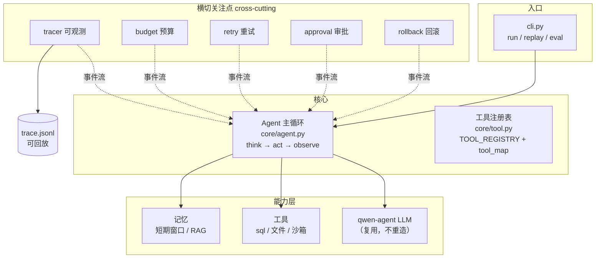

# MiniAgent

一个自研的 **Agent harness**（面试 / 教学项目）。

> 定位：**不重造 LLM，只造 qwen-agent 没做的那一半** —— Agent 骨架 + 生产级可靠性设施。
> LLM 调用直接复用 `qwen_agent.llm.get_chat_model`，其余（主循环、工具系统、记忆、可观测性、安全、可靠性）全部自研。

---

## 为什么做这个项目

市面上的 Agent 框架（qwen-agent 等）大多把重心放在「怎么调 LLM」。但真正拉开差距、也是面试里最被追问的，是这些**LLM 之外的工程问题**：

- 工具挂了怎么办？—— 异常不该炸掉整个主循环
- 死循环 / 超预算怎么办？—— 需要显式上限与止损
- 危险操作（删库、写文件）谁负责？—— 审批闸门 + 沙箱 + 回滚
- 出了 bug 怎么查？—— 事件要能落盘、能回放
- 怎么证明「改一行代码没把东西改坏」？—— 评测 harness

MiniAgent 就是沿这条线，**从最小可跑骨架出发，一层一层把这些「生产特性」补上去**的过程记录。每一步都是独立的小里程碑（P01 → P11），各自有验收测试。

---

## 架构总览



**核心思路：横切关注点通过「事件总线」挂在主循环上，而不是写死在主循环里。** 每加一个可靠性特性，就是多挂一个订阅者，主循环本身几乎不用改。

---

## 功能地图（M1 → P11）

| 编号 | 模块 | 文件 | 解决什么问题 |
|------|------|------|-------------|
| M1 | 主循环 + 工具注册表 | `core/agent.py` `core/tool.py` | 最小可跑骨架 |
| P01 | 事件总线 / 埋点 | `core/hooks.py` `core/hooks_agent.py` | 可观测的基础 |
| P02 | 上下文截断 | `core/context.py` | token 超限怎么办 |
| P03 | 摘要压缩 | `p03/` | 旧对话占窗口怎么办 |
| P04 | 短期记忆 | `memory/short_term.py` | 记得住又不撑爆 |
| —   | RAG 长期记忆 | `memory/embedders.py` `memory/vector_store.py` | 外挂知识库 |
| P05 | Tracer | `runtime/tracer.py` | 事件落盘、可回放 |
| P06 | 预算 | `runtime/budget.py` | token/步数超限止损 |
| P07 | 重试 + 死循环检测 | `runtime/retry.py` | 偶发失败 + 兜底 |
| P08 | 统一 CLI | `cli.py` | 一个入口跑所有事 |
| P09 | 审批闸门 | `runtime/approval.py` | 危险操作人工确认 |
| P10 | checkpoint / 回滚 | `checkpoint/` `runtime/rollback.py` | 改坏了能撤 |
| P11 | 轻量沙箱 | `tools/sandbox.py` | 跑 LLM 生成的代码 |
| M6  | 评测 harness | — | ⬜ 未开始 |
| M7  | 多智能体 | — | ⬜ 未开始 |

---

## 目录结构

```
miniagent/
  cli.py               # ★ 统一入口：run / replay / eval
  llm.py               # LLM 适配器：复用 qwen-agent，只做格式转换
  core/
    message.py         # Message / FunctionCall 数据结构
    tool.py            # ★ 两级注册表 + @tool 装饰器 + BaseTool
    agent.py           # ★ 主循环 Agent.run()
    hooks.py           # 事件类型 + 控制流信号
    hooks_agent.py     # 带埋点的主循环
    context.py         # token 估算 + 上下文截断
    protocols.py       # Protocol 类型（给 mypy 用）
    mem_agent.py       # 带记忆的主循环
  runtime/             # 横切关注点（都靠事件总线挂载）
    tracer.py          # P05 事件落 JSONL + 回放
    budget.py          # P06 token/步数预算
    retry.py           # P07 重试 + 死循环检测
    approval.py        # P09 审批闸门
    rollback.py        # P10 回滚闸门
  checkpoint/
    checkpoint.py      # P10 快照存档
  memory/
    short_term.py      # P04 短期记忆
    embedders.py       # 文本→向量（Hash 玩具 / DashScope 真模型）
    vector_store.py    # 内存版 VectorStore（离线）+ Chroma RAG（真模型）
  tools/
    data_tools.py      # SQLite 只读查询
    demo_tools.py      # 玩具工具（now / add）
    file_tools.py      # P10 文件工具（声明写路径）
    sandbox.py         # P11 轻量沙箱
  p02/ p03/ p04/       # 阶段性里程碑 + 各自验收
  examples/            # 各类 demo（数据 agent / hooks / checkpoint / rag）
  tests/               # 离线验收测试（pytest）
```

---

## 关键设计决策（面试可讲的点）

1. **两级工具注册表**：全局 `TOOL_REGISTRY` 存「类」，Agent 的 `tool_map` 存「实例」。类共享、实例按需带 `cfg` 隔离。
2. **复用而非重造 LLM 层**：直接 `get_chat_model`，只写消息格式双向转换。
3. **横切关注点事件化**：tracer / budget / retry / approval / rollback 都是事件订阅者，主循环无感。
4. **可注入 LLM**：`Agent(llm=...)` 接受任何有 `chat(messages, tools)` 的对象 → 假 LLM 做离线测试。
5. **工具「永不抛异常」契约**：`call()` 永远返回字符串，失败包装成 observation 回给模型，不炸主循环。
6. **凡 LLM 可控的数值都 clamp**：超时、预算、重试次数一律服务端夹到安全区间。
7. **三层防护沙箱**：静态检查（AST）→ 超时 kill → 目录隔离，三件事互相不覆盖；诚实声明「防手滑不防恶意」。
8. **声明式写路径**：工具 `declare_writes()` 声明要改哪些文件，checkpoint 在动手前存档。

---

## 测试

**174 条测试，全部离线可跑**（不调真实 LLM、不烧 API、不需要 API key）。

```bash
.venv\Scripts\python.exe -m pytest miniagent -q        # 全量
.venv\Scripts\python.exe -m pytest miniagent/tests -v  # 看每条
```

覆盖范围：

| 测试文件 | 覆盖 |
|----------|------|
| `test_m1_offline.py` | 主循环 + 工具注册表（假 LLM） |
| `test_p01_hooks.py` | 事件总线 |
| `test_p05_tracer.py` | 事件落盘 + 回放 |
| `test_p06_budget.py` | 预算与 off-by-one 边界 |
| `test_p07_retry.py` | 重试 + 死循环检测 |
| `test_p09_approval.py` | 审批闸门 |
| `test_p10_checkpoint.py` | 存档 / 回滚 |
| `test_p11_sandbox.py` | 沙箱三层防护（27 条） |
| `test_vector_store.py` | RAG 原语（分块 / 余弦 / 内存向量库） |

---

## 怎么跑

在 qwen-agent 仓库根目录下（复用它的 LLM 层）：

```bash
# 统一 CLI
.venv\Scripts\python.exe -m miniagent.cli --help
.venv\Scripts\python.exe -m miniagent.cli run "你的问题"
.venv\Scripts\python.exe -m miniagent.cli run "文档该怎么切分" \
    --rag miniagent/memory/asn.txt --trace trace.jsonl
.venv\Scripts\python.exe -m miniagent.cli replay trace.jsonl

# 沙箱自测（8 组真机输出）
.venv\Scripts\python.exe -m miniagent.tools.sandbox
```

> `run` 会真的调模型，需要 `DASHSCOPE_API_KEY`（写在项目根目录 `.env` 里）。

---

## 依赖

- `qwen-agent` —— 复用 LLM 层
- `chromadb` / `dashscope` —— RAG 向量库与 embedding
- `matplotlib` —— 沙箱画图

---

## 诚实的边界（局限性）

- **沙箱不是真隔离**：静态检查拦不住 `__import__("o"+"s")` 这类运行时拼名字的绕过；真隔离要容器（qwen-agent 的 code_interpreter 走的就是那条路）。
- **LLM 层是复用的**：本项目不涉及流式、tool-call 协议、方言适配这些底层细节。
- **评测 harness（M6）与多智能体（M7）尚未实现**。

---

## 路线图

| 里程碑 | 内容 | 状态 |
|--------|------|------|
| M1 | 主循环 + 两级工具注册表 + LLM 适配器 | ✅ |
| M2 | 上下文管理 + 短期记忆 + RAG | ✅ |
| M3 | Tracer（落盘 + 回放） | ✅ |
| M4 | 预算、重试、死循环检测 | ✅ |
| M5 | 审批闸门 + checkpoint/resume + 沙箱 | ✅ |
| M6 | 评测 harness | ⬜ |
| M7 | 多智能体 orchestrator | ⬜ |

---

## 与 qwen-agent 的对应关系

| MiniAgent | qwen-agent |
|-----------|-----------|
| `core/tool.py` `TOOL_REGISTRY` / `@tool` | `tools/base.py` `TOOL_REGISTRY` / `register_tool` |
| `core/agent.py` `Agent.run()` | `agents/fncall_agent.py` `FnCallAgent._run` |
| `core/message.py` `Message` | `llm/schema.py` `Message` |
| `llm.py` `LLMClient` | `llm/base.py` `BaseChatModel`（直接复用） |
| `tools/sandbox.py` `PythonSandbox` | `tools/code_interpreter.py`（真容器） |
